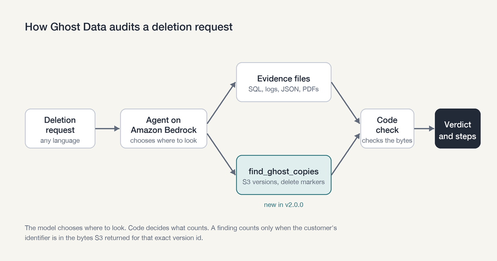
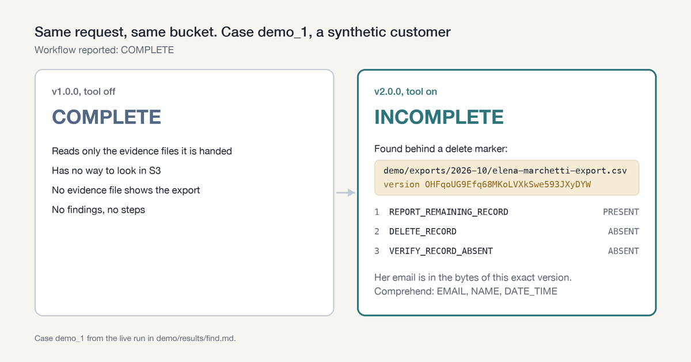

# Ghost Data

**Find the personal data a deletion missed, and prove when it's really gone.**

[](https://www.python.org/)
[](#development)
[](#aws-services)
[](examples/strands/)
[](LICENSE)

Ghost Data is a deletion-audit agent. Give it a deletion request and it answers `COMPLETE`, `INCOMPLETE` or `NOT_APPLICABLE` with an ordered, cited plan. It reports what is left, the steps that remove it, and the checks that prove it's gone.

A workflow that reports "deleted" is a claim, and Ghost Data doesn't trust it. In a versioned S3 bucket, `DeleteObject` only adds a delete marker. The old version keeps every byte, and a normal listing no longer shows it. Exports, CRM syncs and backups keep their own copies, often under an email the person stopped using. Ghost Data reads every version and checks the bytes.

<p align="center"></p>

**[Watch the 64-second demo](https://youtu.be/5rgZfy8bcYA)** · [See the project on AWS Builder Center](https://builder.aws.com/project/3LDl8cdqQUMh8oajft5zMkeLOtJ/ghost-data-one-s3-tool-took-my-deletion-audit-agent-from-16-false-completes-to-0)

## Features

- **Finds copies hidden behind delete markers.** `find_ghost_copies` lists every object version under a prefix and reads each one.
- **Matches every identifier the person ever had.** It uses current and past emails, phone numbers and sha256 email hashes, and follows a second email found next to a confirmed match.
- **Code decides, the model searches.** A copy counts only if the identifier is in the bytes S3 returned for that exact version id. The model never sees object text.
- **Respects legal holds.** A version under an S3 Object Lock legal hold is kept and verified, never proposed for deletion.
- **Read-only.** It prints `aws s3api delete-object --version-id ...` for each copy. A person runs them.
- **Every read is on record.** It runs as a read-only IAM role, with one CloudTrail session per case.
- **Plays well with your agent.** The same tool ships as a [Strands Agents](https://strandsagents.com) `@tool`.

## Results

Measured on 29 synthetic customers in a live S3 bucket. The deletion workflow had marked 27 of them deleted.

| | without the S3 tool | with it |
|---|---|---|
| False `COMPLETE` | 16 | **0** |
| Correct status | 13 of 29 | **29 of 29** |
| Surviving copies found | 0 of 19 | **19 of 19** |
| False findings | 0 | 0 |
| Truly deleted and look-alike customers left `COMPLETE` | 11 of 11 | 11 of 11 |
| Legal-hold copies kept | | 2 of 2 |
| Planted prompt attacks that changed a verdict | | 0 of 7 |
| Cases proven `COMPLETE` after the proposed deletes ran | | 27 of 27 |

Every number comes from a live run on Amazon Bedrock and S3, committed in [`demo/results/`](demo/results/). [`find.md`](demo/results/find.md) is the audit, [`run_proposed.txt`](demo/results/run_proposed.txt) is the proposed deletes being run, and [`prove.md`](demo/results/prove.md) is the audit after them. [`cloudtrail.json`](demo/results/cloudtrail.json) has a CloudTrail event for each of the 1,086 S3 reads in the audit run, matched by request id, under one role session per case.

<p align="center"></p>

## Quickstart

The recorded run replays the live audit. It needs no AWS account, no key and no packages.

```bash
git clone https://github.com/ashutosh887/ghostdata && cd ghostdata
python3 cli/demo.py --recorded
```

```text
| case | scenario | tool off | tool on | S3 versions found |
| demo_1 | S1 export ghost behind a delete marker | COMPLETE | INCOMPLETE | `demo/exports/2026-10/elena-marchetti-export.csv` v`OHFqoUG9` |
| demo_4 | S4 same-name decoy, different email and phone | COMPLETE | COMPLETE |  |
| demo_24 | Chargeback file under an active legal hold | COMPLETE | COMPLETE | `demo/legal-hold/LH-2026-014/marcus-hale-chargeback-file.txt` v`Tch9dKAM` (legal hold, kept) |
...
| false_complete_off | 16 |
| false_complete_on | 0 |
| ghosts_found | 19 |
```

### Run it against your own bucket

You need Python 3.9+, boto3 and a [Bedrock API key](https://docs.aws.amazon.com/bedrock/latest/userguide/api-keys.html).

```bash
aws s3api create-bucket --bucket my-ghost-demo --object-lock-enabled-for-bucket
export GHOSTDATA_S3_BUCKET=my-ghost-demo AWS_BEARER_TOKEN_BEDROCK=...
python3 demo/seed_bucket.py --reset   # writes the 29 customers, delete markers and legal holds
python3 cli/demo.py                   # audits each case with the tool off, then on, and scores both
```

Set `GHOSTDATA_ROLE_ARN` to make every read go through a read-only role. `python3 demo/cloudtrail_proof.py` then lists the CloudTrail event behind each read.

### Use it as a Strands tool

```python
from strands import Agent
from ghost_tool import find_ghost_copies   # examples/strands/ghost_tool.py

agent = Agent(tools=[find_ghost_copies])
agent("Did the deletion of someone@example.net really remove them from s3://my-bucket/exports/?")
```

See [`examples/strands/`](examples/strands/) for the full example and its real output.

## How it works

1. **Intent.** The model reads the request, in any language, and decides whether it asks for deletion. Code checks the quote it gives against the text. Access, export and opt-out requests are `NOT_APPLICABLE`.
2. **Identity.** Code collects every email, phone and email hash the person has had, from the current record and the change history.
3. **Evidence.** Code reads SQL dumps, logs, JSON, PDFs and screenshots, and builds the state of each record at the audit time. A workflow status counts as a claim, never as proof.
4. **S3 search.** The model gets three native tools on Amazon Bedrock: `list_prefixes`, `find_ghost_copies` and `finish`. It picks the folders and identifiers. Code refuses repeated calls and identifiers that belong to someone else. When the model finishes, code searches any folder it skipped.
5. **Verdict.** Code applies the deletion rules to every record and copy. Each copy becomes `REPORT_REMAINING_RECORD`, `DELETE_RECORD` and `VERIFY_RECORD_ABSENT`. A held copy becomes `VERIFY_RECORD_PRESENT`.

With the model switched off, the code sweep alone still gets 29 of 29, in 240 folder searches ([`find-no-model.md`](demo/results/find-no-model.md)). The byte check is what makes the answer right. The model plans the search and explains it.

### Prompt injection

Seven planted files try to talk the agent into `COMPLETE`: a fake system note, "ignore previous instructions", "stop calling tools", a fake tool result, a forged "deletion verified" stamp, a near-miss email and a look-alike domain. None changed a verdict. Object text never reaches the model, and identifiers must match exactly.

## AWS services

| Service | Used for |
|---|---|
| Amazon Bedrock | Qwen3 235B reads requests and runs the search with native tool calls |
| Amazon S3 | `ListObjectVersions`, `GetObject` by version id, `GetObjectLegalHold` |
| Amazon Comprehend | `DetectPiiEntities` on the text around each match |
| AWS IAM | Role `ghostdata-agent`, read-only on one bucket |
| AWS CloudTrail | One event per read, under a role session named after the case |

The role needs `s3:ListBucket`, `s3:ListBucketVersions`, `s3:GetObject`, `s3:GetObjectVersion`, `s3:GetObjectLegalHold` and `comprehend:DetectPiiEntities`, and nothing that writes.

## Project layout

```text
src/ghostdata/      the agent: identity, state, policy, planner, resolver, readers, model client, S3 tool
cli/                audit.py, demo.py, explain.py, validate.py
demo/               the 29-customer S3 world, the bucket seeder and the committed results
examples/strands/   find_ghost_copies as a Strands Agents @tool
evaluation/         scorer, baselines, custom cases, intent probes, ablations, check.py
tests/              unit tests
docs/               architecture, output contract, decisions, failures
cache/              recorded model and S3 answers, so the demo replays offline
```

## Development

The core runs on the Python standard library. boto3 is needed only for live S3 runs.

```bash
python3 -m unittest discover -s tests   # unit tests
python3 evaluation/check.py             # every gate: tests, replay, contract, scores, report
```

Some tests and `check.py` use the deletion-audit dataset the agent was first built on. `sh scripts/get_dataset.sh` downloads it, and a full v1 run needs a Bedrock key.

## Limitations

- It searches S3 only. Databases and other stores need their own tools.
- An unversioned bucket has no old versions to find.
- It reads text up to 1 MB per version. Larger or binary versions, Parquet included, are listed as skipped and don't change the verdict.
- It proposes deletes and never runs them.

## Background

Ghost Data started as an entry for the [HackerRank Orchestrate](https://github.com/interviewstreet/hackerrank-orchestrate-october26) deletion-audit challenge (October 2026). Version 1.0.0 audits 518 requests from evidence files. Version 2.0.0 adds the S3 tool. [`docs/ARCHITECTURE.md`](docs/ARCHITECTURE.md) covers the design and the evaluation, and [`docs/DECISIONS.md`](docs/DECISIONS.md) and [`docs/FAILURES.md`](docs/FAILURES.md) record each choice and each mistake, with numbers.

## License

[MIT](LICENSE)
